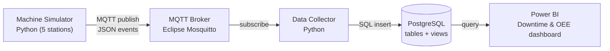

# Smart Factory Downtime & OEE Pipeline

An end-to-end Industrial IoT (IIoT) data pipeline for a simulated 5-station engine assembly line.
Machine events travel over **MQTT**, are validated and stored in **PostgreSQL**, and are turned into
**OEE, downtime and root-cause analysis** in a **Power BI** dashboard.

> All data in this project is simulated. No real plant data is used.

---

## What it does

- **Simulates a production line** of 5 PLC-style stations (OP10 Block Load to OP50 Leak Test) with realistic
  cycle times, scrap, faults and repair times.
- **Models line behaviour**: when a station faults, the next station becomes *Starved* and the previous
  station becomes *Blocked*, just like a real line.
- **Publishes machine data over MQTT** (the publish/subscribe protocol widely used in IIoT).
- **Collects, validates and stores** every message in PostgreSQL, rejecting bad data and tracking how long
  each station spends in each state.
- **Calculates OEE** (Availability x Performance x Quality), downtime by station, shift and fault reason.
- **Visualises everything in Power BI**, including a fault Pareto chart and live station status.

## Architecture



| Layer | Component | Technology |
|---|---|---|
| Equipment | Machine simulator (acts like PLC data) | Python |
| IIoT messaging | MQTT broker, topic per station: `factory/line3/OP10/event` | Eclipse Mosquitto (Docker) |
| Integration | Collector: validation, state tracking, heartbeat gap detection | Python, paho-mqtt, psycopg |
| Data | Raw events, state intervals, part cycles, SQL views | PostgreSQL 16 (Docker) |
| Visual management | OEE, downtime, Pareto, trend, live status | Power BI, DAX |

## Message format

```json
{"line": "LINE3", "station": "OP40", "ts": "2026-10-24T13:14:04.000Z", "type": "STATE", "state": "FAULTED", "fault_code": "F401"}
{"line": "LINE3", "station": "OP10", "ts": "2026-10-24T13:15:02.000Z", "type": "CYCLE", "cycle_time_s": 58.4, "result": "GOOD"}
{"line": "LINE3", "ts": "2026-10-24T13:15:00.000Z", "type": "HEARTBEAT"}
```

## Database

| Table / view | Purpose |
|---|---|
| `stations` | Stations and their ideal cycle times |
| `fault_codes` | Fault reasons with category (Mechanical, Electrical, Quality, Material, Safety, Planned) |
| `machine_events` | Raw copy of every valid message (audit trail) |
| `state_intervals` | Time each station spent Running, Faulted, Starved, Blocked or Stopped |
| `part_cycles` | Every finished part with cycle time and good/scrap result |
| `v_downtime` | Finished downtime periods with reason, category, shift and production date |
| `v_station_status` | Current state of every station |
| `v_oee_daily` | Daily OEE building blocks per station |

## How OEE is calculated

| Factor | Formula |
|---|---|
| Availability | Run time / Planned time (planned stops such as tool changes are excluded) |
| Performance | (Ideal cycle time x Total parts) / Run time |
| Quality | Good parts / Total parts |
| **OEE** | **Availability x Performance x Quality** |

The SQL view stores the building blocks (run seconds, planned seconds, parts), and DAX measures divide the
sums, so line-level OEE stays correct when filters are applied.

## Data quality features

- Rejects invalid messages (bad JSON, unknown station or fault code, missing fields, negative cycle times,
  timestamps without a time zone) and counts them.
- Ignores out-of-order and duplicate state messages.
- Uses a **heartbeat** every 60 seconds. If no data arrives for 3 minutes, open intervals are closed at the
  last known time, so an outage is never counted as production or downtime.
- Uses MQTT QoS 1 with a persistent session, so the collector can catch up after a restart.

## What the data shows (7 simulated days)

- OEE per station is about 79-84% against an 85% target.
- *Starved* and *Blocked* are the largest downtime, but they are symptoms. The Pareto chart filters them out
  to show the real root causes: robot gripper faults, conveyor jams and torque out of spec.
- Night shift has the most downtime.
- OP50 Leak Test has the lowest quality because leak failures scrap parts.

## Run it locally

Requirements: Docker Desktop, Python 3.11+

```bash
cp .env.example .env              # on Windows: copy .env.example .env
docker compose up -d              # starts MQTT broker and PostgreSQL
python -m venv .venv
.venv\Scripts\Activate.ps1        # macOS/Linux: source .venv/bin/activate
pip install -r requirements.txt
python db/init_db.py              # creates tables, reference data and views
```

Then, in two terminals:

```bash
python collector/collector.py
python simulator/simulator.py --backfill-days 7 --seed 42
```

The simulator loads 7 days of history and then keeps running live. Check the data with:

```bash
python db/check_data.py
```

Connect Power BI Desktop to PostgreSQL (server `localhost:5432`, database `factory`) and load the three views.

## Tests

24 automated tests cover the simulator (line behaviour, heartbeats, repeatable data, realistic availability)
and the collector (validation, interval durations, out-of-order handling, data gaps, downtime view).
Database tests use a separate `factory_test` database.

```bash
pytest -v
```

## Project structure

```
collector/collector.py     MQTT subscriber, validation, state tracking
simulator/simulator.py     5-station line simulator, MQTT publisher
db/schema.sql              tables, indexes, reference data, views
db/init_db.py              applies the schema
db/check_data.py           prints OEE, downtime and live status
db/reset_data.py           clears machine data
tests/                     pytest suites
powerbi/                   Power BI report and PDF export
mosquitto/mosquitto.conf   broker configuration
docker-compose.yml         MQTT broker and PostgreSQL
```

## Production notes

This is a learning project. A production deployment would add MQTT authentication and TLS, database SSL,
network segmentation between OT and IT systems, and secrets management instead of a `.env` file.

## Author

**Devarshi Patel** · [Portfolio](https://devarshi-patel.vercel.app/) · [LinkedIn](https://www.linkedin.com/in/devarshipatel237/) · [GitHub](https://github.com/Devarshi2323)